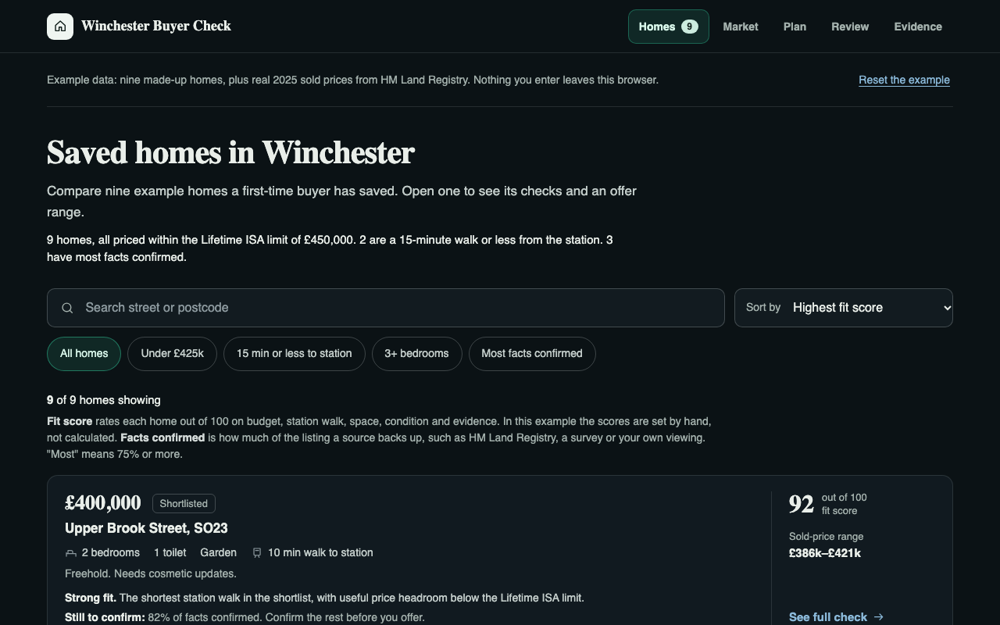
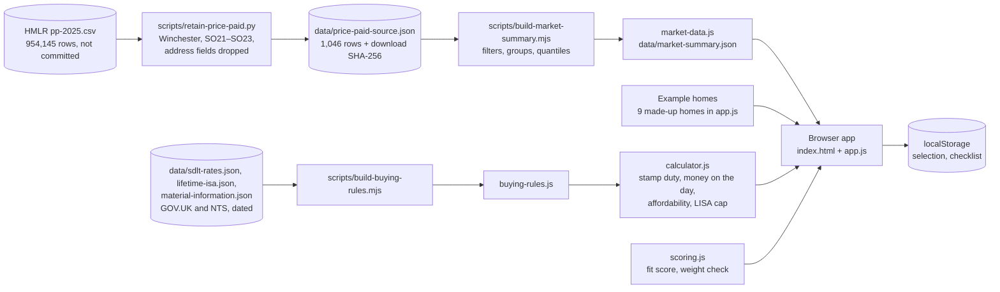

# Winchester Buyer Check: evidence before an offer

A browser-only decision aid for first-time buyers in Winchester: it puts price, commute, the true cost of buying and source evidence side by side, so a viewing is judged on traceable data before it turns into an emotional offer.

[](https://github.com/MatthewPaver/winchester-buyer-check/actions/workflows/pages.yml)
[](LICENSE)



**Live demo:** <https://matthewpaver.github.io/winchester-buyer-check/>. No sign-up or install. Try **Within my plan**, open a home, see the money you need on the day, tick off its checklist, then change the numbers and weights on the Plan page.

The nine saved homes are made-up examples. The market view is built from a real, traceable 2025 HM Land Registry snapshot. Stamp duty and Lifetime ISA rules come from GOV.UK and are dated. The fit score and decision checks are fixed, readable rules; there is no AI or LLM in this project, and nothing you enter leaves the browser.

## The problem

A first-time buyer in Winchester with a Lifetime ISA (LISA) has a hard ceiling: the LISA can only be used on a home costing £450,000 or less. Asking prices sit close to that line, listing photos do the persuading, and the evidence that should decide an offer (what similar homes actually sold for, how long the walk to the station really is, which facts are only the agent's claim) is scattered or missing.

The demo keeps that evidence in one place:

1. **Can I afford it, and what do I need on the day?** A plan for deposit, loan and monthly payment that works out the most you can pay after stamp duty, conveyancing, survey, lender fee, moving, the cash you keep back and first-year works. Each home shows the money needed on completion day line by line.
2. **Does the Lifetime ISA still apply?** The £450,000 cap, the 12-month rule, the 25% bonus and the 25% withdrawal charge, stated once where they matter.
3. **How do the homes compare?** A fit score out of 100 from five parts (budget, walk to the station, bedrooms, condition, facts confirmed), each marked against a fixed yardstick. You choose how much each part counts, and the list says whether its ranking holds if one weight moves by a fifth. Homes within your plan sort first.
4. **What did comparable homes sell for?** The middle half of 2025 sale prices and the median by outward postcode and property type, from HMLR Price Paid Data, with your plan maximum drawn across the chart.
5. **What still needs checking?** A per-home checklist built on the National Trading Standards material information list (Parts A to C) plus three checks of your own, a source register, rule-based checks on finance, commute and evidence, and an offer range that never goes above your plan.

## Quickstart

No dependencies to run it. Tests use Node 22 and Python 3.13 (the CI versions).

```bash
git clone https://github.com/MatthewPaver/winchester-buyer-check.git && cd winchester-buyer-check
python3 -m http.server 8765                       # then open http://127.0.0.1:8765/
node --test tests/*.test.cjs                      # expect: # pass 30, # fail 0
python3 -m unittest discover -s tests -p 'test_*.py'   # expect: OK
```

The optional browser journey (desktop and mobile navigation, the plan filter and sort, the market chart, stamp duty and Lifetime ISA sections, the out-of-budget offer actions, the checklist, no third-party requests) needs the server running and Playwright:

```bash
python3 -m venv .venv && .venv/bin/python -m pip install playwright==1.58.0
.venv/bin/python -m playwright install chromium && .venv/bin/python tests/smoke.py
```

Screenshots go to `/tmp` unless `WINCHESTER_SHOWCASE_PATH` is set; `WINCHESTER_BASE_URL` overrides the default port.

## How it works



| Path | Role |
| --- | --- |
| `scripts/retain-price-paid.py` | Projects a downloaded HMLR yearly CSV to Winchester district, SO21–SO23 and seven columns; records the whole-file SHA-256 |
| `data/price-paid-source.json` | The committed, address-minimised snapshot the app is built from |
| `scripts/build-market-summary.mjs` | Applies the inclusion filters and writes groups, counts and percentile bands to `market-data.js` and `data/market-summary.json` |
| `data/sdlt-rates.json`, `data/lifetime-isa.json`, `data/material-information.json` | Stamp duty bands, Lifetime ISA rules and the material information checklist, each with its source URLs and the date it was last checked |
| `scripts/build-buying-rules.mjs` | Copies those three files into `buying-rules.js` so the page needs no fetch; CI fails if the copy drifts |
| `calculator.js` | Pure functions for stamp duty, buying costs, money on the day, affordability and the offer range, shared by the browser and the Node tests |
| `scoring.js` | The fit score: fixed-anchor marks, weights as shares of 1, ranking and the one-at-a-time weight check |
| `app.js` | The single-page UI: saved homes list, market view, plan, review, evidence checklist. State stays in the browser |
| `DESIGN.md` | The design contract: tokens, type, spacing, colour roles, components, motion and banned patterns |
| `docs/ROADMAP.md` | Next steps (map, walking areas, area facts) with their sources and licences |
| `docs/MARKET_DATA_CONTRACT.md` | Exact filters, counts, quantile method and what the snapshot must not be used to claim |

## Results: what the data supports

The market view reconciles from the official download to the numbers on screen. Every count below is recorded in `data/market-summary.json` and re-derived by the tests.

| Stage | Rows |
| --- | --- |
| HMLR 2025 yearly file, retrieved 5 September 2026 | 954,145 |
| Retained: district `WINCHESTER`, outward postcode SO21, SO22 or SO23 | 1,046 |
| Included: category A, record status A, four residential types, £50,000–£3,000,000 | 931 |
| Grouped: outward postcode × property type | 12 groups, 931 sales |

Reproduce from the committed snapshot, with no network access:

```bash
node scripts/build-market-summary.mjs && node scripts/build-buying-rules.mjs && git diff --exit-code -- data/market-summary.json market-data.js buying-rules.js
```

CI runs exactly this and fails if the regenerated files differ by a byte. The Node tests also check the source SHA-256, recount every group independently, and confirm that no full postcode or street address is retained.

To refresh from HMLR (about 159 MiB; never needed to run the demo):

```bash
curl --fail --location https://price-paid-data.publicdata.landregistry.gov.uk/pp-2025.csv -o /tmp/pp-2025.csv
python3 scripts/retain-price-paid.py /tmp/pp-2025.csv && node scripts/build-market-summary.mjs
```

HMLR revises the yearly file monthly, so a new download is a new snapshot and should be reviewed as one.

What this does not show:

- **A valuation.** The bands are the observed 25th–75th percentiles of completed 2025 sales in a postcode and type group. They are not confidence intervals and say nothing about a specific home.
- **Anything about the nine homes.** They are fictional and not linked to any HMLR transaction. Their facts (price, walk, bedrooms, condition, share of facts confirmed) and one-line verdicts are written by hand in `app.js`. The fit score is computed from those facts and your plan; it does not use the market data.

## Design decisions and trade-offs

- **Static and browser-only over a backend.** An earlier private prototype (now archived) had accounts, persistent workspaces and background jobs. This edition has none: nothing to host or secure, and inputs never leave the browser (`localStorage`). Cost: no saved workspace across devices and no live listings.
- **A committed, address-minimised projection over fetching HMLR at runtime or committing the full CSV.** The app and its tests work offline, the 159 MiB file stays out of Git, and only transaction ID, price, date, outward postcode, type, category and record status are kept. Cost: the snapshot ages, and refreshing it is a manual, reviewed step.
- **Generated market figures, checked in CI, over hand-entered numbers.** An earlier version showed a market claim with no traceable source; it was replaced by this pipeline. Every figure on the market screen is produced by one script from one checksummed file. Cost: an extra build step that must be re-run after any change to the source or filters.
- **Fixed-threshold rules over a model or LLM score.** The review checks are explicit: the most your plan allows (the same calculation as the Plan page), the £450,000 LISA cap, a station walk of 15 or 22 minutes, evidence coverage of 75%. Anyone can read why a home is flagged, and the same inputs always give the same answer. Cost: the thresholds are judgement calls, not calibrated against outcomes.
- **Fixed anchors over ranking against the shortlist.** Each part of the fit score is marked against a fixed yardstick (for example full marks for a walk of 15 minutes or less, half at 22), not scaled between the best and worst home on the list. Adding or removing a home never changes another home's score. A one-at-a-time check moves each weight by a fifth and reports whether the top three change. Cost: the anchors are stated assumptions; the app lets you change the weights, not the anchors.
- **Budget inside the score and in the sort.** Budget is a scored part (no marks over the plan), and the default sort puts homes within the plan first, so a well-located home you cannot afford never leads the list.
- **Dated rules in data files over numbers in code.** Stamp duty bands and Lifetime ISA rules live in `data/` with their GOV.UK source and a `lastVerified` date, and the tests check the GOV.UK worked examples. Cost: someone has to re-check them when the rules change.
- **Fictional homes over real listings.** Scraping property portals raises rights questions, and showing a real address invites people to treat the demo's view of it as fact. Cost: the saved homes list demonstrates the workflow, not a live search.

## Limits and non-goals

- Not financial, mortgage, tax or legal advice. The calculator is illustrative; see [NOTICE.md](NOTICE.md).
- No live listings, no listing search, no account, no mortgage decision and no offer submission.
- Market context covers 2025 completed sales only, for one district and three outward postcodes.
- Commute is a station walk time per example home, not a routed journey.
- Stamp duty covers residential homes in England and Northern Ireland for a buyer who will own one home. It does not model the higher rates for additional homes, the non-resident surcharge or shared ownership.
- Buying costs other than stamp duty are example figures for you to replace with quotes. Offer ranges come from simple illustrative rules.
- One app.js of about 1,150 lines renders every screen. That suits a static demo; a larger product would split it.
- A map, walking areas and area facts are planned, not built. See [docs/ROADMAP.md](docs/ROADMAP.md).

## Repository layout and tests

```text
index.html, app.js, styles.css   the single-page app
calculator.js                    stamp duty, buying costs, affordability and offer range (browser + Node)
scoring.js                       fit score and weight sensitivity (browser + Node)
buying-rules.js                  generated browser copy of the dated rules in data/
market-data.js                   generated market view loaded by the page
assets/fonts/                    self-hosted DM Sans and Fraunces (SIL Open Font License)
data/                            retained HMLR source, generated summary JSON, dated rule files
scripts/                         retain-price-paid.py, build-market-summary.mjs, build-buying-rules.mjs
tests/                           Node tests (calculator, stamp duty, scoring, rules, market data), Python projection tests, Playwright journey
docs/                            market data contract, roadmap, README screenshot
```

CI ([`pages.yml`](.github/workflows/pages.yml)) runs on every push and pull request: the Node and Python tests, the byte-identical regeneration check and the Playwright journey. It deploys to GitHub Pages only from `main` and only after those pass.

## Sources and credits

- **Fit score method:** after [FlatScorer](https://github.com/Aduneer/FlatScorer) by Aduneer (MIT): fixed anchors instead of min-max scaling, weights as shares that sum to 1, and a weight-perturbation check on ranking stability. Reimplemented in `scoring.js` for homes rather than rentals; no FlatScorer code is copied.
- **Stamp duty:** [GOV.UK residential property rates](https://www.gov.uk/stamp-duty-land-tax/residential-property-rates) and [First-Time Buyers' Relief](https://www.gov.uk/guidance/stamp-duty-land-tax-relief-for-land-or-property-transactions), rates from 1 April 2025, checked 28 Oct 2026.
- **Lifetime ISA:** [GOV.UK Lifetime ISA](https://www.gov.uk/lifetime-isa) and [withdrawing money](https://www.gov.uk/lifetime-isa/withdrawing-money-from-your-lifetime-isa), checked 28 Oct 2026, with the June 2026 [First Time Buyer ISA consultation](https://www.gov.uk/government/consultations/first-time-buyer-isa-consultation/first-time-buyer-isa-consultation) noted.
- **Checklist:** National Trading Standards Estate and Letting Agency Team, material information quick guide for property agents (v1.0, November 2023), Parts A to C, and the government's 2025 [material information consultation](https://www.gov.uk/government/consultations/material-information-in-property-listings/material-information-in-property-listings).
- **Chart and status colours:** checked with a dataviz palette validator (lightness band, chroma floor, colour-blind separation, contrast) in dark mode; the values are in [DESIGN.md](DESIGN.md).
- **Fonts:** [DM Sans](https://github.com/googlefonts/dm-fonts) and [Fraunces](https://github.com/undercasetype/Fraunces), SIL Open Font License 1.1, licence files in `assets/fonts/`.

## Licence

Code: MIT. See [LICENSE](LICENSE). The project name and artwork are excluded; see [NOTICE.md](NOTICE.md).

Market data: contains HM Land Registry data © Crown copyright and database right 2021. This data is licensed under the Open Government Licence v3.0.
